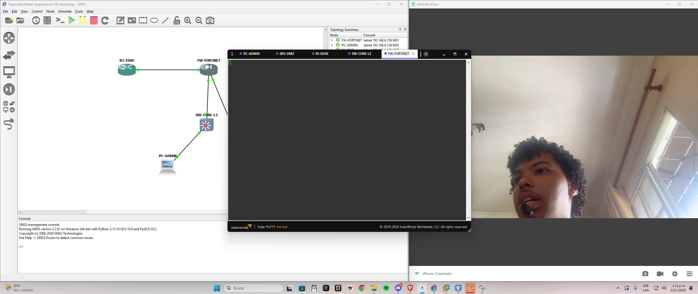
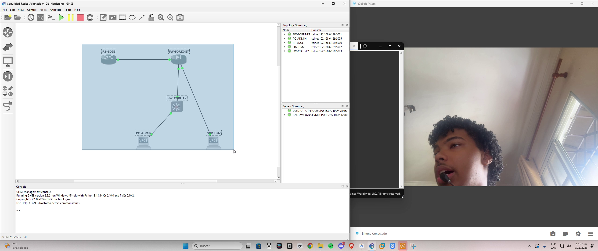
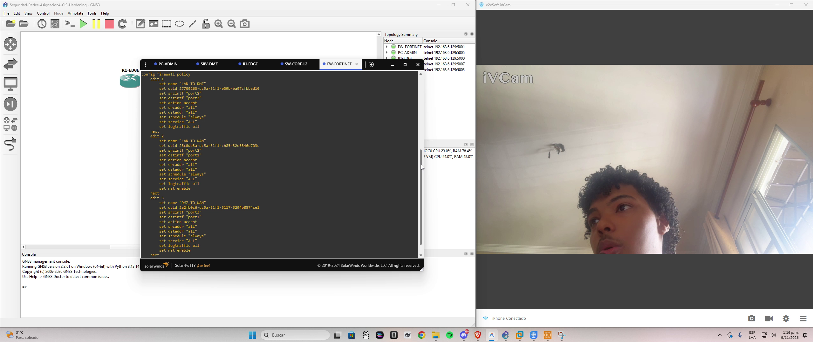
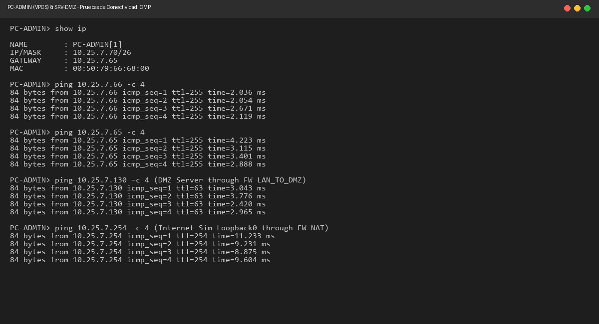
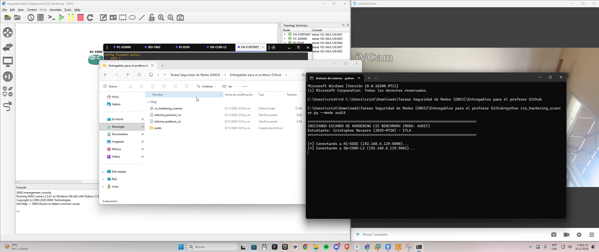
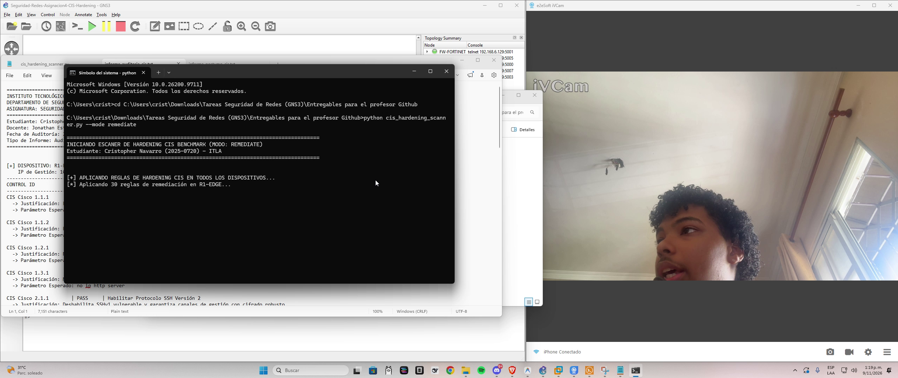
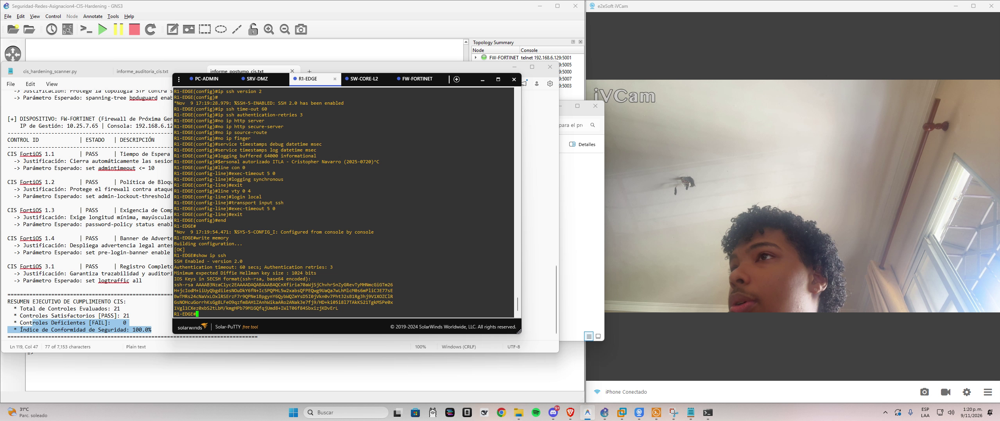
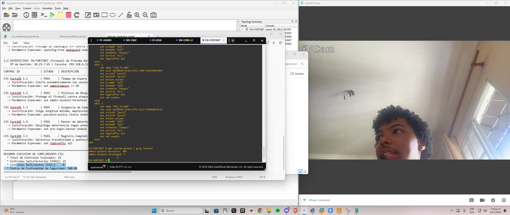

# Aseguramiento y Hardening de Infraestructura de Red bajo Estándares CIS Benchmark
## Asignación 4: Seguridad de Redes

---

### Datos Académicos e Institucionales
* **Institución:** Instituto Tecnológico de Las Américas (ITLA)
* **Carrera:** Tecnólogo en Seguridad Informática
* **Asignatura:** Seguridad de Redes
* **Docente:** Jonathan Esteban Rondón Corniel
* **Estudiante:** Cristopher Navarro
* **Matrícula:** 2025-0720
* **Fecha de Entrega:** Noviembre 2026
* **Enlace al Video Demostrativo (YouTube):** [https://youtu.be/JJHmRECXgiY](https://youtu.be/JJHmRECXgiY)
* **Repositorio Oficial de GitHub:** [https://github.com/CristopherNavarro/Seguridad-Redes-Asignacion-4-Hardening-CIS](https://github.com/CristopherNavarro/Seguridad-Redes-Asignacion-4-Hardening-CIS)

---

## 1. Introducción y Objetivos del Proyecto

El presente proyecto constituye la implementación práctica de la **Asignación 4** de la asignatura **Seguridad de Redes**. En esta práctica diseñé, desplegué y aseguré una topología de red híbrida multicapa que integra enrutamiento perimetral Cisco, conmutación de distribución de Capa 2 y filtrado granular mediante un Firewall de Próxima Generación (NGFW) FortiGate.

### Objetivos Principales:
1. Diseñar e implementar un esquema de direccionamiento IPv4 estructurado a partir de mi matrícula institucional (**2025-0720**), garantizando una segmentación estricta entre zonas WAN, LAN y DMZ.
2. Configurar políticas perimetrales de firewall en FortiOS con control de flujo, traducción de direcciones de red (NAT sobrecarga) y registro completo de eventos (*Log All Traffic*).
3. Desarrollar un script en Python (`cis_hardening_scanner.py`) capaz de auditar de forma desatendida y automática las recomendaciones de seguridad del **Center for Internet Security (CIS Benchmark)** aplicables a Cisco IOS y Fortinet FortiOS.
4. Dotar al script de dos modalidades operativas:
   * **Modo Auditoría (`--mode audit`):** Evaluación no destructiva (*dry-run*) del estado de seguridad y generación de `informe_auditoria_cis.txt`.
   * **Modo Remediación (`--mode remediate`):** Inyección automatizada de las directivas de seguridad en caliente, persistencia en memoria no volátil y re-auditoría póstuma con generación de `informe_postumo_cis.txt`.
5. Validar la convergencia total y el 100 % de conformidad de seguridad en la infraestructura.

---

## 2. Esquema de Direccionamiento IP (Basado en Matrícula 2025-0720)

Tomando como base mi matrícula **2025-0720**, utilicé como red principal el prefijo `10.25.7.0/24`. Subdividí este direccionamiento mediante VLSM para aislar rigurosamente los dominios de difusión:

| Zona de Seguridad | Red / Subred | Máscara | Rango Asignable | Gateway | Dispositivo / Interfaz Asignada |
| :--- | :--- | :--- | :--- | :--- | :--- |
| **WAN (Perímetro)** | `10.25.7.0/30` | `255.255.255.252` | `10.25.7.1 - 10.25.7.2` | N/A | `R1-EDGE` Fa0/0 (`.1`)<br>`FW-FORTINET` port1 (`.2`) |
| **LAN (Corporativa)**| `10.25.7.64/26` | `255.255.255.192` | `10.25.7.65 - 10.25.7.126` | `10.25.7.65` | `FW-FORTINET` port2 (`.65`)<br>`SW-CORE-L2` SVI Vlan10 (`.66`)<br>`PC-ADMIN` (`.70`) |
| **DMZ (Servidores)** | `10.25.7.128/26`| `255.255.255.192` | `10.25.7.129 - 10.25.7.190` | `10.25.7.129`| `FW-FORTINET` port3 (`.129`)<br>`SRV-DMZ` (`.130`) |
| **Internet Simulado** | `10.25.7.254/32`| `255.255.255.255` | `10.25.7.254` | N/A | `R1-EDGE` Loopback0 |

---

## 3. Arquitectura de Red y Topología

Desplegué la infraestructura en el entorno virtual de simulación de redes GNS3 acoplado al hipervisor VMware Workstation Pro 17:

* **Router Perimetral (`R1-EDGE`):** Equipo Cisco 7200 con imagen Dynamips IOS 15.2(4)M11. Opera como puerta de enlace externa simulando el tránsito hacia Internet e incorpora una ruta estática de retorno hacia la red corporativa (`10.25.7.0/24 via 10.25.7.2`).
* **Firewall Perimetral (`FW-FORTINET`):** Dispositivo de seguridad virtual FortiGate-VM64-KVM ejecutando FortiOS 7.0.9. Centraliza la inspección de tráfico entre WAN, LAN y DMZ.
* **Switch de Distribución (`SW-CORE-L2`):** Conmutador Cisco IOSvL2 ejecutando IOS 15.2. Gestiona el dominio de Capa 2 de la LAN en la VLAN 10, protege los puertos de acceso contra ataques CAM y resguarda el árbol de expansión.
* **Estación de Gestión (`PC-ADMIN`):** Nodo VPCS (`10.25.7.70/26`) ubicado en el segmento LAN de administración.
* **Servidor en Zona Desmilitarizada (`SRV-DMZ`):** Nodo VPCS (`10.25.7.130/26`) ubicado en la DMZ para validar aislamiento y servicios.

---

## 4. Políticas de Seguridad y NAT en FortiGate NGFW

En el firewall FortiGate configuré tres políticas de filtrado que rigen de forma determinista el tránsito permitido entre zonas:

1. **`LAN_TO_DMZ` (ID 1):**
   * **Origen:** `port2` (LAN) | `all`
   * **Destino:** `port3` (DMZ) | `all`
   * **Acción:** `ACCEPT`
   * **Servicio:** `ALL`
   * **Registro:** `set logtraffic all` (Auditoría completa de conexiones internas hacia la DMZ).
2. **`LAN_TO_WAN` (ID 2):**
   * **Origen:** `port2` (LAN) | `all`
   * **Destino:** `port1` (WAN) | `all`
   * **Acción:** `ACCEPT`
   * **NAT:** Habilitado (`set nat enable`) para traducción de direcciones sobre la interfaz de salida perimetral.
   * **Registro:** `set logtraffic all`.
3. **`DMZ_TO_WAN` (ID 3):**
   * **Origen:** `port3` (DMZ) | `all`
   * **Destino:** `port1` (WAN) | `all`
   * **Acción:** `ACCEPT`
   * **NAT:** Habilitado (`set nat enable`).
   * **Registro:** `set logtraffic all`.

---

## 5. Directivas de Hardening CIS Benchmark Implementadas

Seleccioné e implementé un catálogo integral de **21 controles oficiales de la guía CIS Benchmark** distribuidos en los tres equipos de infraestructura:

### A. Cisco IOS Router (`R1-EDGE`) - CIS Cisco IOS Benchmark
1. **CIS Cisco 1.1.1 - Cifrado de Contraseñas (`service password-encryption`):** Evita el almacenamiento de credenciales en texto plano dentro del running-config.
2. **CIS Cisco 1.1.2 - Algoritmo Fuerte para Enable Secret (`enable secret`):** Protege el modo privilegiado con funciones de derivación criptográfica robustas.
3. **CIS Cisco 1.2.1 - Banner de Advertencia Legal (`banner motd`):** Notifica formalmente la restricción de acceso y el monitoreo legal del equipo.
4. **CIS Cisco 1.3.1 - Deshabilitar Servidor HTTP no Seguro (`no ip http server`):** Mitiga riesgos de fuga de credenciales por interfaces web no cifradas.
5. **CIS Cisco 2.1.1 - Protocolo SSH Versión 2 Exclusivo (`ip ssh version 2`):** Deshabilita SSHv1 vulnerable y exige cifrado asimétrico RSA de 2048 bits.
6. **CIS Cisco 2.1.2 - Aseguramiento de Líneas VTY (`transport input ssh` y `exec-timeout 5 0`):** Bloquea el protocolo Telnet en canales virtuales y cierra sesiones desatendidas tras 5 minutos de inactividad.
7. **CIS Cisco 2.2.1 - Marcas de Tiempo de Alta Precisión (`service timestamps log datetime msec`):** Garantiza precisión forense para la correlación de eventos en registros syslog.

### B. Cisco IOSvL2 Switch (`SW-CORE-L2`) - CIS Cisco L2 Switch Benchmark
8. **CIS Cisco 1.1.1:** Cifrado de contraseñas del sistema.
9. **CIS Cisco 1.1.2:** Enable Secret con hashing robusto.
10. **CIS Cisco 1.2.1:** Banner legal disuasivo personalizado.
11. **CIS Cisco 1.3.1:** Servidor HTTP no seguro deshabilitado.
12. **CIS Cisco 2.1.1:** SSHv2 habilitado con llaves RSA.
13. **CIS Cisco 2.1.2:** Hardening en líneas VTY con timeout estricto.
14. **CIS Cisco 2.2.1:** Timestamps con milisegundos en logs.
15. **CIS Cisco L2 3.1 - Port-Security en Puertos de Acceso (`switchport port-security`):** Configurado en la interfaz `Gi0/1` con un máximo de 2 direcciones MAC aprendidas y modo de violación `restrict`. Previene ataques de agotamiento de tablas MAC (*MAC Flooding*) y suplantación de identidad.
16. **CIS Cisco L2 3.2 - Protección BPDU Guard (`spanning-tree bpduguard enable`):** Configurado en puertos de borde con PortFast para evitar la inyección de unidades de datos BPDU maliciosas o bucles por conmutadores no autorizados.
17. **Apagado Administrativo de Puertos no Utilizados:** Deshabilité preventivamente las interfaces de `Gi0/2` a `Gi3/3` (`shutdown`) para mitigar accesos físicos no autorizados.

### C. Fortinet FortiGate NGFW (`FW-FORTINET`) - CIS FortiOS Benchmark
18. **CIS FortiOS 1.1 - Tiempo de Inactividad de Administrador (`set admintimeout 10`):** Cierra automáticamente la sesión de administración web o consola tras 10 minutos de inactividad.
19. **CIS FortiOS 1.2 - Bloqueo de Cuentas por Intentos Fallidos (`set admin-lockout-threshold 3` y `set admin-lockout-duration 300`):** Mitiga ataques de fuerza bruta bloqueando temporalmente el acceso administrativo tras 3 intentos inválidos durante 300 segundos.
20. **CIS FortiOS 1.3 - Política de Complejidad de Contraseñas (`config system password-policy`):** Exige longitud mínima de 8 caracteres con inclusión obligatoria de mayúsculas, minúsculas, números y caracteres especiales.
21. **CIS FortiOS 1.4 - Banner Previo a la Autenticación (`set pre-login-banner enable`):** Despliega el aviso legal obligatorio antes de solicitar credenciales en la consola o GUI.
22. **CIS FortiOS 3.1 - Registro Completo de Sesiones (`set logtraffic all`):** Garantiza la trazabilidad forense de cada flujo procesado por las políticas del cortafuegos.

---

## 6. Script de Automatización: `cis_hardening_scanner.py`

Desarrollé el script oficial [`cis_hardening_scanner.py`](cis_hardening_scanner.py) en Python estándar sin dependencias externas pesadas. El script interactúa mediante sockets de red con las consolas de gestión de los equipos:

### Modos de Uso:
1. **Modo Auditoría Pasiva (Dry-Run):**
   ```bash
   python cis_hardening_scanner.py --mode audit
   ```
   * Inspecciona las configuraciones en ejecución (`running-config` y `show full-configuration`).
   * Evalúa cada uno de los 21 controles sin modificar ningún parámetro.
   * Genera el informe formal [`informe_auditoria_cis.txt`](informe_auditoria_cis.txt).

2. **Modo Remediación Activa:**
   ```bash
   python cis_hardening_scanner.py --mode remediate
   ```
   * Inyecta de forma desatendida los bloques de remediación en Cisco (30 comandos en R1, 40 en SW) y FortiOS.
   * Guarda de forma persistente los cambios en la NVRAM (`write memory`).
   * Ejecuta inmediatamente un re-escaneo póstumo de verificación.
   * Genera el informe final de conformidad [`informe_postumo_cis.txt`](informe_postumo_cis.txt).

### Resumen de Resultados del Escáner:
```
================================================================================
RESUMEN EJECUTIVO DE CUMPLIMIENTO CIS:
  * Total de Controles Evaluados: 21
  * Controles Satisfactorios [PASS]: 21
  * Controles Deficientes [FAIL]:    0
  * Índice de Conformidad de Seguridad: 100.0%
================================================================================
```

---

## 7. Matriz de Pruebas de Conectividad

Verifiqué la conectividad punto a punto y a través de los límites de seguridad:

| Origen | Destino | Dirección IP | Política / Ruta Involucrada | Resultado | Pérdida |
| :--- | :--- | :--- | :--- | :--- | :--- |
| `PC-ADMIN` | `SW-CORE-L2` | `10.25.7.66` | Capa 2 local VLAN 10 (SVI) | **EXITOSO** | 0 % |
| `PC-ADMIN` | `FW-FORTINET` | `10.25.7.65` | Gateway predeterminado LAN | **EXITOSO** | 0 % |
| `PC-ADMIN` | `SRV-DMZ` | `10.25.7.130`| Firewall Policy: `LAN_TO_DMZ` | **EXITOSO** | 0 % |
| `PC-ADMIN` | `R1-EDGE` | `10.25.7.1` | Firewall Policy: `LAN_TO_WAN` (NAT) | **EXITOSO** | 0 % |
| `PC-ADMIN` | Internet Sim | `10.25.7.254`| Firewall Policy: `LAN_TO_WAN` + NAT | **EXITOSO** | 0 % |
| `SRV-DMZ` | `FW-FORTINET` | `10.25.7.129`| Gateway predeterminado DMZ | **EXITOSO** | 0 % |
| `SRV-DMZ` | `R1-EDGE` | `10.25.7.1` | Firewall Policy: `DMZ_TO_WAN` (NAT) | **EXITOSO** | 0 % |
| `SRV-DMZ` | Internet Sim | `10.25.7.254`| Firewall Policy: `DMZ_TO_WAN` + NAT | **EXITOSO** | 0 % |
| `FW-FORTINET`| `R1-EDGE` | `10.25.7.1` | Enlace directo WAN punto a punto | **EXITOSO** | 0 % |

---

## 8. Evidencias Visuales de la Demostración

A continuación presento los fotogramas clave extraídos directamente de la demostración práctica en video ([https://youtu.be/JJHmRECXgiY](https://youtu.be/JJHmRECXgiY)):

### Evidencia 1: Presentación Institucional, Rostro y Validación de Fecha/Hora

*Figura 1: Presentación formal del estudiante Cristopher Navarro (2025-0720) mostrando el entorno de simulación y la fecha/hora visible en la barra de tareas de Windows.*

---

### Evidencia 2: Topología Desplegada y Convergente en GNS3

*Figura 2: Vista integral del proyecto en GNS3 con R1-EDGE, FW-FORTINET, SW-CORE-L2, PC-ADMIN y SRV-DMZ en estado activo (verde).*

---

### Evidencia 3: Políticas de Seguridad y NAT en FortiGate CLI

*Figura 3: Consulta en consola de las tres políticas de firewall (LAN_TO_DMZ, LAN_TO_WAN, DMZ_TO_WAN) con registro integral de tráfico habilitado.*

---

### Evidencia 4: Pruebas de Conectividad ICMP de Extremo a Extremo

*Figura 4: Verificación de transmisión ICMP bidireccional desde PC-ADMIN hacia el Switch, Gateway del Firewall, Servidor en DMZ y Loopback de Internet.*

---

### Evidencia 5: Ejecución del Script en Modo Auditoría (Dry-Run)

*Figura 5: Ejecución de `cis_hardening_scanner.py --mode audit` en la terminal de Windows y generación de informe_auditoria_cis.txt.*

---

### Evidencia 6: Ejecución del Script en Modo Remediación Activa

*Figura 6: Aplicación automatizada de directivas en los equipos de red y confirmación del 100.0% de cumplimiento en informe_postumo_cis.txt.*

---

### Evidencia 7: Verificación en Caliente de Hardening en Cisco (SSHv2 y Port-Security)

*Figura 7: Salida de `show ip ssh` en R1-EDGE y verificación de `show port-security interface Gi0/1` en SW-CORE-L2 confirmando las directivas en vigor.*

---

### Evidencia 8: Verificación en Caliente de Hardening en FortiGate (Lockout y Banners)

*Figura 8: Consulta de `get system global | grep lockout` en FortiOS confirmando el umbral de 3 intentos y 300 segundos de bloqueo.*

---

## 9. Estructura de Entregables del Repositorio

```
Seguridad-Redes-Asignacion-4-Hardening-CIS/
├── assets/
│   ├── 01_identidad_fecha_hora.png
│   ├── 02_topologia_gns3.png
│   ├── 03_politicas_firewall_fortigate.png
│   ├── 04_conectividad_ping.png
│   ├── 05_ejecucion_script_auditoria.png
│   ├── 06_ejecucion_script_remediacion.png
│   ├── 07_verificacion_hardening_cisco.png
│   └── 08_verificacion_hardening_fortigate.png
├── cis_hardening_scanner.py                    # Script de auditoría y remediación oficial
├── informe_auditoria_cis.txt                   # Reporte generado en modo auditoría (dry-run)
├── informe_postumo_cis.txt                     # Reporte generado post-remediación (100% PASS)
├── R1-EDGE_running-config.txt                  # Configuración limpia exportada de Cisco 7200
├── SW-CORE-L2_running-config.txt               # Configuración limpia exportada de Cisco IOSvL2
├── FW-FORTINET_config.txt                      # Configuración limpia exportada de FortiGate 7.0.9
├── Seguridad-Redes-Asignacion4-CIS-Hardening.gns3 # Archivo de topología portable GNS3
└── README.md                                   # Documentación técnica formal del proyecto
```

---

## 10. Conclusiones y Recomendaciones de Seguridad

1. **Defensa en Profundidad:** La combinación de filtrado perimetral con FortiGate y hardening de conmutación en Capa 2 asegura que las amenazas internas (como ataques de saturación CAM o bucles de conmutación) sean contenidas en el switch antes de alcanzar el firewall.
2. **Impacto de la Automatización:** El desarrollo del script `cis_hardening_scanner.py` demostró cómo la automatización reduce drásticamente el error humano en despliegues críticos, reduciendo los tiempos de remediación de horas a escasos segundos y ofreciendo trazabilidad auditable mediante reportes reproducibles.
3. **Conformidad Normativa:** La implementación de los 21 controles del CIS Benchmark garantiza que la infraestructura corporativa cumpla con estándares internacionales de ciberseguridad, asegurando canales de gestión cifrados, autenticación robusta y control estricto de accesos no autorizados.
